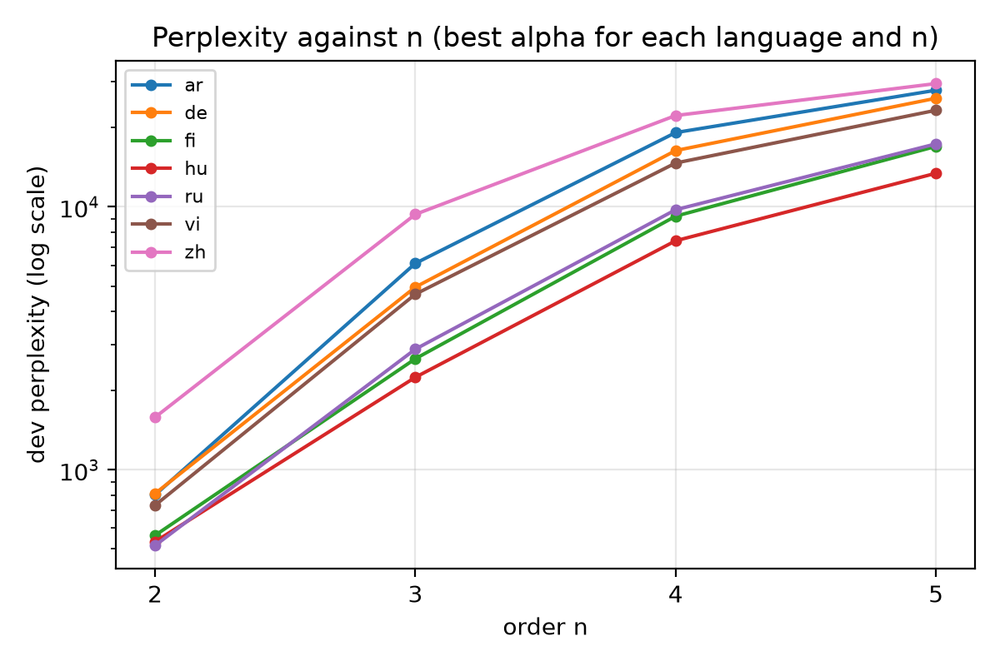

# A1 Part 3: n-gram language model

An n-gram language model over my 50,000-token BPE plus an EOS token (50,001 tokens), with maximum-likelihood or
add-alpha smoothing, evaluated by perplexity and bits per character.

## Files (project root)

- `ngram.py`: n-gram counting, probabilities, perplexity and bits-per-character
- `part3_ngram_lm.py`: train and evaluate one model
- `part3.py`: sweep n = 2 to 5 and alpha, write `results.csv` and the perplexity-vs-n plot, train the best setting
- `part3_unseen.py`: share of dev tokens whose n-gram or context was never seen in training
- Course-provided and not included: `part3_artifacts.py`

## Run (from the project root)

```bash
uv run python part3_ngram_lm.py --input artifacts/part1/cleaned --bpe artifacts/part1/bpe \
    --order 2 --smoothing add-alpha --alpha 0.003
uv run python part3.py --input artifacts/part1/cleaned --bpe artifacts/part1/bpe/ --output artifacts/part3/
uv run python part3_unseen.py --input artifacts/part1/cleaned --bpe artifacts/part1/bpe
```

The sweep takes about 10 minutes and under 7 GB of memory.

## Results

- Selected setting: **n = 2, add-alpha with alpha = 0.003**, chosen as the lowest dev perplexity in the sweep.
- Dev perplexity **828.9**, **3.220 bits per character**.
- The write-up (section 3.4) measures how often higher-order n-grams were never seen in training.


