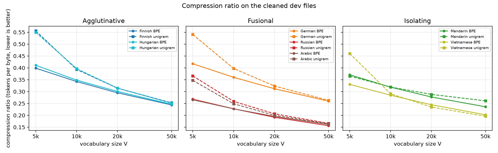
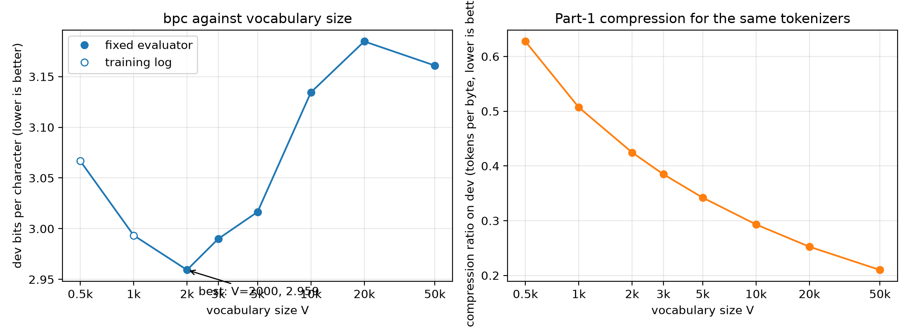

<!-- Build: pandoc writeup.md -o writeup.pdf --pdf-engine=xelatex -->

# AI use declaration

I used Claude (an AI assistant, through Claude Code) throughout this assignment, for two things.

- **Learning the material.** I used it to learn the content of the assignment. I am not familiar with NumPy or many of the libraries, so we discussed each algorithm (cleaning, BPE, the encoder, the Transformer setup, n-gram models) and how to implement it.
- **Writing the code.** Claude helped me implement it, and wrote much of the code. I wrote some parts myself, such as the `TextCleaner` class and its pipeline idea, `encode` and `decode` in `bpe.py`, and the first version of `count_ngrams`. Claude reviewed these and fixed bugs. Whenever a piece of code was not clear to me, I had Claude explain it until I understood it.

- **Understanding the questions.** Claude explained the assignment questions, the action items, and what analysis I needed to give.
- **Writing the analysis.** I gave my answers in my own words, as unstructured analysis, and Claude drafted them into a more coherent text. The main ideas in the analysis are mine. Claude checked my claims against the numbers and corrected some of them, and added a few points that I then accepted: the measurement of unseen n-grams (3.4), the compression-ratio breakdown by bytes per character (1.5), and the embedding-table and context-window points (2.2).

I ran the Colab training myself. I checked the results, and I can explain the code.

# Part 1: Data cleaning and byte-level BPE

## 1.1 Data cleaning

These are the UTF-8 byte counts of the raw files and my cleaned files.

| Language | Raw train | Clean train | Raw dev | Clean dev |
|---|---:|---:|---:|---:|
| Finnish | 17,029,153 | 10,054,732 | 1,678,953 | 1,007,788 |
| Hungarian | 17,379,397 | 10,297,728 | 1,790,559 | 1,037,031 |
| German | 18,347,716 | 10,156,114 | 1,749,689 | 999,266 |
| Russian | 30,104,329 | 17,292,723 | 3,137,332 | 1,708,571 |
| Arabic | 30,075,317 | 17,082,509 | 2,987,657 | 1,724,378 |
| Mandarin Chinese | 54,629,674 | 24,376,713 | 5,226,036 | 2,465,252 |
| Vietnamese | 21,539,469 | 12,378,648 | 2,208,053 | 1,266,992 |

I cleaned the text with a pipeline of small steps, each one removing or fixing one kind of wiki markup. They run in this order:

1. Remove HTML comments, `<ref>` tags with their content, and any other HTML tags (keeping the text between them).
2. Remove templates `{{ ... }}` and tables `{| ... |}`. They can contain each other, so I match the opening and closing marks with a stack. If a match would span a huge amount of text, I treat the marks as stray and keep the text.
3. Remove `----` lines and words like `__TOC__`.
4. For Chinese, pick one version out of the `-{ ... }-` variants: zh-hans first, then zh-cn, then zh-sg.
5. Turn links into their text (`[[a|b]]` becomes `b`), and drop category, file, image and other-language links.
6. Remove external link markup and bare URLs, bold and italic quotes, heading marks (`==`), and list marks (`*`, `#`, `:`, `;`).
7. Decode HTML entities, turn unusual spaces into a normal space, and delete invisible characters.
8. Clean up whitespace: collapse repeated spaces, strip each line, and allow at most one blank line in a row. Each file ends with one newline.

## 1.2 Byte-level BPE

### Do merges cross line boundaries?

My trainer lets me give a set of strings (I call them barriers) that merges may not cross or join with the text next to them. I added this because I thought that merging across lines, or across other boundaries, could join pieces that are not related, and that might make training a language model harder.

For the submitted tokenizer I decided to use **no barriers**, so newline is just a normal byte, and merges can cross lines. I did this to get a better compression ratio. I tested both options at V = 50,000, with the newline as the only barrier. I measured tokens per byte on the cleaned dev files (lower is better): 0.2100 without barriers and 0.2156 with the newline barrier, so no barriers uses 2.7% fewer tokens overall (between 1.7% and 4.0% fewer depending on the language).

The difference is small, and this only measures compression.

## 1.3 Encoder and decoder

Out-of-vocabulary means a piece of text that the tokenizer has no token for. Character-level BPE starts with the characters it saw in the training text. A character that was never seen has no token, so it has to become an unknown token, and then the original text can not be recovered. There are about 150,000 Unicode characters, so putting all of them in the starting vocabulary is not practical. It is more than my whole 50,000-token vocabulary, and most of them would never show up in training, so the model could not learn anything about them.

Byte-level BPE starts from the 256 byte values. Every text in a computer is stored as bytes, and every character is 1 to 4 of them, so any text can be encoded and then decoded back exactly. An unseen character just becomes a few byte tokens (for example, a rare Chinese character that is not in the training text is split into two tokens in my tokenizer, and decodes back correctly).

This matters for my data. The training text has 11,394 different characters. In the dev text there are 219 characters that never appear in training (rare Chinese characters, for example), 315 occurrences out of 6.7 million. A character-level tokenizer could not encode those. Also, a character-level tokenizer would need 11,394 of the 50,000 vocabulary slots just for single characters, while byte-level BPE needs 256.

## 1.5 Compression across morphological types

For each vocabulary size V in 5,000, 10,000, 20,000 and 50,000, I trained both tokenizers on the same cleaned training text (all seven languages together) and measured the compression ratio (tokens per UTF-8 byte, lower is better) on the cleaned dev file of each language. BPE was retrained at each size. For unigram I used a character coverage of 0.9995, except at V = 5,000, where it does not fit in the vocabulary, so I used 0.999.

{width=100%}

Compression ratio (tokens per byte) of BPE:

| Language | V = 5k | 10k | 20k | 50k | drop from 5k to 50k |
|---|---:|---:|---:|---:|---:|
| Finnish | 0.3987 | 0.3422 | 0.2948 | 0.2437 | 39% |
| Hungarian | 0.4108 | 0.3482 | 0.3006 | 0.2465 | 40% |
| German | 0.4174 | 0.3601 | 0.3119 | 0.2597 | 38% |
| Russian | 0.2680 | 0.2275 | 0.1916 | 0.1562 | 42% |
| Arabic | 0.2655 | 0.2273 | 0.1953 | 0.1614 | 39% |
| Mandarin | 0.3707 | 0.3186 | 0.2771 | 0.2360 | 36% |
| Vietnamese | 0.3303 | 0.2848 | 0.2445 | 0.2021 | 39% |

Compression ratio (tokens per byte) of unigram:

| Language | V = 5k | 10k | 20k | 50k |
|---|---:|---:|---:|---:|
| Finnish | 0.5557 | 0.3932 | 0.3141 | 0.2527 |
| Hungarian | 0.5493 | 0.3968 | 0.3146 | 0.2506 |
| German | 0.5407 | 0.3974 | 0.3234 | 0.2627 |
| Russian | 0.3662 | 0.2587 | 0.2066 | 0.1663 |
| Arabic | 0.3474 | 0.2486 | 0.2000 | 0.1642 |
| Mandarin | 0.3652 | 0.3191 | 0.2881 | 0.2610 |
| Vietnamese | 0.4605 | 0.2909 | 0.2347 | 0.1962 |

The compression ratio is

$$\text{compression ratio} = \frac{\text{tokens}}{\text{bytes}} = \frac{\text{tokens} / \text{characters}}{\text{bytes} / \text{characters}}$$

so it depends on two things: how many tokens the tokenizer needs per character, and how many bytes one character takes in UTF-8, which depends on the script (a Latin letter takes about 1 byte, a Cyrillic or Arabic letter 2, and a Chinese character 3). The table splits the ratio into these two parts for the BPE tokenizer at V = 50,000 on the cleaned dev files.

| Language | Type | Bytes per character | Tokens per character | Tokens per byte (compression ratio) |
|---|---|---:|---:|---:|
| Finnish | agglutinative | 1.04 | 0.253 | 0.244 |
| Hungarian | agglutinative | 1.10 | 0.271 | 0.246 |
| German | fusional | 1.02 | 0.264 | 0.260 |
| Russian | fusional | 1.78 | 0.278 | 0.156 |
| Arabic | fusional | 1.78 | 0.288 | 0.161 |
| Vietnamese | isolating | 1.29 | 0.261 | 0.202 |
| Mandarin | isolating | 2.65 | 0.626 | 0.236 |

To compare the languages without the effect of the script, I also counted tokens per word for the six languages that use spaces (BPE tokenizer), and the number of different word forms among the first 100,000 words of each dev file. Mandarin has no spaces, so I give characters per token instead.

| Language | Type | Different word forms per 100,000 words | BPE tokens per word, V = 5k | V = 50k |
|---|---|---:|---:|---:|
| Finnish | agglutinative | 39,642 | 3.58 | 2.19 |
| Hungarian | agglutinative | 35,637 | 3.33 | 2.00 |
| German | fusional | 30,377 | 3.16 | 1.97 |
| Russian | fusional | 37,295 | 3.52 | 2.05 |
| Arabic | fusional | 33,370 | 2.84 | 1.73 |
| Vietnamese | isolating | 11,282 | 2.00 | 1.22 |
| Mandarin | isolating | not measured (no spaces) | 1.02 characters per token | 1.60 characters per token |

### Analysis

As the vocabulary grows, the compression ratio gets lower (better), because more whole words and large word pieces can be stored as single tokens. With a small vocabulary, each word has to be built from several tokens. All the languages improve by a similar amount from 5k to 50k (36% to 42% for BPE), and the gains get smaller at larger sizes.

How a language builds its words affects how well it compresses. In an agglutinative language like Finnish or Hungarian, a word chains several suffixes, each with one meaning, so a word has more pieces and needs more tokens (2.2 and 2.0 tokens per word at V = 50,000). In a fusional language, one ending carries several meanings at once, so words have fewer pieces (1.7 to 2.1 tokens per word). The difference is small, though: Russian (2.05) needs more tokens per word than Hungarian (2.00), and it has as many different word forms. Vietnamese, an isolating language, has short words that do not change form, so it has the fewest different word forms (about 11,000) and needs only 1.2 tokens per word.

The script matters as well, because the compression ratio is tokens per byte. Russian and Arabic compress best (about 0.16 at V = 50,000), mainly because their letters take 2 bytes. A Mandarin character takes about 3 bytes (2.65 on average in the dev file), so once the most common characters are single tokens the ratio is already low: at V = 5,000 it is 0.371, better than Finnish, Hungarian and German (0.399 to 0.417). But Mandarin gains the least from a larger vocabulary (36% from 5k to 50k, against 38% to 42% for the others), and at V = 50,000 it is 0.236, close to Finnish (0.244). Per character it needs the most tokens (0.63, against 0.25 to 0.29 for the other languages), and its tokens stay close to single characters (1.6 characters per token, against 3.5 to 4). A possible reason is that Chinese has a very large set of characters (about 4,000 cover 99.9% of the text) and no spaces, so after the common characters the longer tokens would have to be multi-character words and phrases, which repeat less often than the words of the languages with spaces. The differences between the agglutinative and fusional languages are small, and they depend on the measure and on other things such as the script, compounding, and which articles are in the dev file.

The two tokenizers show the same overall pattern. BPE is better than unigram at most sizes, especially at 5k (for Finnish the unigram ratio is 39% worse), and the gap is small at 50k. When I lowered the unigram character coverage at 5k, the gap shrank a lot for most languages, so much of it comes from unigram using up small vocabularies on single characters.

# Part 2: Bits per character

## 2.1 Baseline

I trained the provided Transformer (29.9M parameters, 2000 steps, on a Colab T4) on the ids from my Part 1 byte-level BPE with V = 50,000, and scored it with the fixed evaluator `part2_eval_bpc.py` on the concatenated cleaned dev files (6,733,934 characters). The whole pipeline ran end to end: cleaned text, tokenizer, token ids, training, and evaluation.

**The baseline dev bpc is 3.161** (token perplexity 975).

## 2.2 Optimizing bpc: the submitted tokenizer

I submit the V = 2,000 byte-level BPE, trained by `part2.py` with the same code as Part 1 (no barriers), with its checkpoint in `artifacts/part2/`. It had the lowest dev bpc of the eight sizes I tried (2.959 against 3.161 for the 50k baseline; the sweep is in 2.3). I did not try another tokenizer algorithm.

## 2.3 Analysis: the tokenization–compression tradeoff

I kept the algorithm (my byte-level BPE) and the model, the data, and the 2000 training steps fixed, and changed only V. The table has dev bpc from the fixed evaluator, except the two rows marked *training log*. For those two sizes I did not keep the checkpoints (I ran out of GPU credits), so the number is the final dev bpc printed by the training script, which uses the same scoring code. For the six other sizes the training script and the evaluator gave the same bpc to four decimals.

| V | dev bpc | tokens per byte | source |
|---:|---:|---:|---|
| 500 | 3.067 | 0.627 | training log |
| 1,000 | 2.993 | 0.507 | training log |
| **2,000** | **2.959** | 0.425 | fixed evaluator |
| 3,000 | 2.990 | 0.385 | fixed evaluator |
| 5,000 | 3.016 | 0.342 | fixed evaluator |
| 10,000 | 3.134 | 0.293 | fixed evaluator |
| 20,000 | 3.185 | 0.252 | fixed evaluator |
| 50,000 | 3.161 | 0.210 | fixed evaluator |

**The sweet spot is around V = 2,000.** That size has the lowest bpc, 2.959, which is 6.4% lower than the 50k baseline. The bpc gets worse (higher) below 2k, at 1k and 500, and above 2k, from 3k up to 20k. The exact best size is not certain: 2k and 3k differ by only 0.03, and I trained one run per size, so I can say the best V is between 1k and 3k but not more precisely.

The curve is not perfectly smooth. 50k (3.161) is a little better than 20k (3.185), which does not fit the idea that a larger V always does worse. The difference is small and I only have one run per size, so I treat it as noise, but I have not shown that.

**Why there is a sweet spot.** This is my analysis and reasoning for why these numbers occurred.

- *Large V:* the tokens get rarer. Most of the 50k tokens are rare, and with only 2000 training steps the model sees each of them too few times to learn it well. Most of the model's parameters are also in the embedding and output tables (about 19M of 29.9M at 50k), so a large vocabulary leaves less of the model for the language itself.
- *Small V:* the tokens get too general. A token at 500 or 1,000 is a short piece that carries little meaning by itself, so the model has to put many pieces together to get a word. There are also many more tokens to predict (0.63 tokens per byte at 500, against 0.21 at 50k), and the 256-token context covers less text: about 400 bytes at V = 500, about 600 at 2k, and about 1,200 at 50k.
- *Around 2k:* a token is still common enough to be learned well in 2000 steps, and it is still long enough to carry some of the structure of a word.

The sweet spot depends on the training budget. The reason large V does badly here is that the model has only 2000 steps to learn the rare tokens, and I expect the best V to move up with longer training.

**Does better compression always mean lower bpc? No.** Compression (right panel) gets better at every step as V grows, from 0.63 tokens per byte at 500 to 0.21 at 50k, but the bpc does not. The bpc is the cost per token divided by the characters per token. Better compression only raises the characters per token. It does not tell us how many bits each token costs, and that cost goes up when the tokens are rarer and the choice is among more of them. At V = 2,000 the compression is twice as bad as at 50k (0.425 against 0.210) and the bpc is lower.

# Part 3: N-gram language model

I count n-grams over my Part 1 byte-level BPE tokens (V = 50,000, plus the end-of-sequence token EOS, so 50,001 in total), on the cleaned train files of all seven languages put together. Each line is encoded on its own and ends with EOS, and no n-gram crosses a line. A token is predicted from the up to n − 1 tokens before it in the same line, with no backoff:

$$P(w \mid \text{ctx}) = \frac{C(\text{ctx}, w) + \alpha}{C(\text{ctx}) + \alpha \cdot V}, \qquad V = 50{,}001$$

where α = 0 is plain maximum likelihood. For the first token of a line the context is empty, and C(()) is the total number of training tokens. I train once at order 5 and use the count tables of orders 1 to n for a model of order n (`part3.py`). Everything below is on the concatenated cleaned dev files (2,236,260 tokens, 6,733,934 characters).

## 3.1 Maximum likelihood

The maximum likelihood model gives an infinite perplexity at every order, n = 2, 3, 4 and 5, because some dev token has an n-gram that never appears in training, so its probability is 0.

- For n = 2 the first one is the bigram (14323, 2303), which is the token " 29" followed by " آ" (an Arabic letter). This pair does not occur in the training text.
- For n = 3, 4 and 5 the first one is the trigram (1927, 13197, 1300), which is "29", " مارس" (Arabic for March), " أو" (Arabic for "or"). It is the same trigram for the three orders because it is the third token of a line, where the context is only two tokens long for any n ≥ 3.

## 3.2 Add-α smoothing

I tried α from 1 down to 0.000001 for every order. The table has the dev perplexity and, in brackets, the bits per character for every setting I tested (all languages). The best α for each n is in bold.

| α | n = 2 | n = 3 | n = 4 | n = 5 |
|---|---:|---:|---:|---:|
| 1 | 6,332 (4.194) | 26,351 (4.877) | 35,917 (5.025) | 38,816 (5.062) |
| 0.1 | 1,789 (3.588) | 14,298 (4.584) | 27,192 (4.892) | 32,701 (4.980) |
| 0.03 | 1,121 (3.364) | 10,142 (4.419) | 23,265 (4.817) | 29,811 (4.936) |
| 0.01 | 881 (3.249) | 7,522 (4.276) | 20,290 (4.752) | 27,553 (4.898) |
| 0.003 | **829 (3.220)** | 5,671 (4.141) | 17,677 (4.686) | 25,506 (4.861) |
| 0.001 | 906 (3.262) | **4,763 (4.057)** | 15,880 (4.634) | 24,025 (4.833) |
| 0.0001 | 1,350 (3.453) | 5,116 (4.092) | **14,263 (4.583)** | **22,329 (4.798)** |
| 1e-05 | 2,167 (3.680) | 9,965 (4.411) | 16,577 (4.655) | 23,263 (4.817) |
| 1e-06 | 3,508 (3.911) | 25,924 (4.869) | 23,319 (4.818) | 26,592 (4.881) |
| 0 (maximum likelihood) | ∞ | ∞ | ∞ | ∞ |

The best α gets smaller as n grows. For each n the neighbouring values of α on both sides are worse (for example n = 2: 0.01 gives 881, 0.003 gives 829, 0.001 gives 906), so the best α is inside the range I tried. Every value in the sweep is in `artifacts/part3/results.csv`.

## 3.3 Selected model

I selected **n = 2 with α = 0.003**: dev perplexity 828.9 and 3.220 bits per character. It is saved with `part3_artifacts.save_ngram_model` in `artifacts/part3/model.json.gz` (35.2 MB). I chose it because it has the lowest dev perplexity (and the lowest bpc) of all the (n, α) settings I tried.

\newpage

## 3.4 Analysis

**a) Perplexity against n, and where smoothing matters most**

{width=75%}

**What the curves show.** For all seven languages the perplexity gets worse as n grows. For each language and each n, the plot uses the α with the lowest dev perplexity. These values are between 0.01 and 0.0001, and they get smaller as n grows. With them, Finnish goes from 563 at n = 2 to 16,985 at n = 5, German from 812 to 25,893, and Mandarin from 1,584 to 29,440. The same three languages have the lowest perplexity at every n (Hungarian, Finnish and Russian), and Mandarin has the highest.

A bigger n means a longer context, and a longer context is more specific. The problem is that each long context appears only rarely, and I train on about 21M tokens, which is not much for 50,000 token types. At n = 2 the model only uses the previous token, and most of those appear many times in training, so the counts are reliable. With n = 5 most contexts never appeared in training at all, so the model has nothing to count, and the average surprise per token is very high.

**Where smoothing matters most.** I measured how much of the dev set has no counts (`part3_unseen.py`):

| n | dev tokens with an unseen n-gram | dev tokens with an unseen context |
|---:|---:|---:|
| 2 | 21.0% | 0.0% |
| 3 | 65.3% | 20.9% |
| 4 | 81.8% | 64.8% |
| 5 | 87.3% | 80.3% |

Smoothing matters more and more as n grows. At n = 2 about a fifth of the dev tokens depend on it, and at n = 5 almost nine out of ten. When the context was never seen, both counts are 0 and the formula gives (0 + α) / (0 + α · 50,001) = 1/50,001 for every token, which is a uniform guess. At n = 5 that is the case for 80% of the tokens, which is why its perplexity is so high. So the smoothing is what keeps the model finite at all orders, but at high n it does not give a good model, because there is almost nothing real to smooth.

This also explains the choice of α. If α is 0, one unseen token has infinite surprise. If α is very small (10⁻⁶), the unseen tokens still get almost no probability, and the perplexity is high (3,508 at n = 2). If α is large (1), the unseen tokens get so much probability that the real counts do not matter (6,332 at n = 2). The best α is between the two, and it gets smaller for larger n.

**b) Does a larger BPE vocabulary make smoothing more or less important?**

More important. A larger vocabulary has more token types, so there are many more possible n-grams, but the amount of training text stays the same. More of the n-grams in new text were then never seen in training, so more tokens depend on smoothing. A smaller vocabulary has fewer possible n-grams, so more of them are seen and the counts are more reliable.

The smoothing term α · V also grows with V, so the same α adds more pretend counts when the vocabulary is larger. These can drown out the real counts, so the best α has to be smaller for a larger vocabulary.
